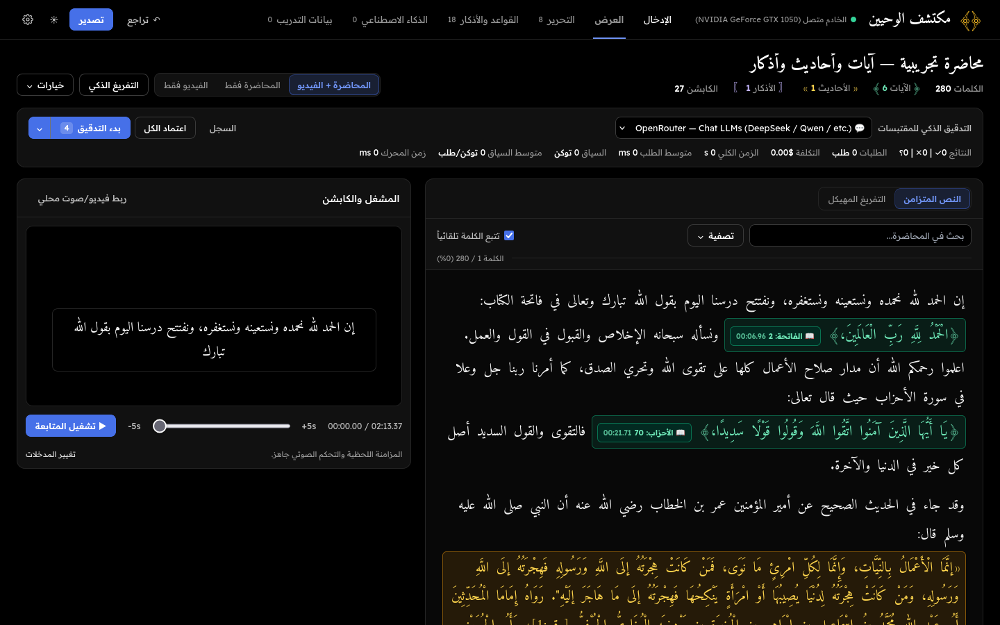
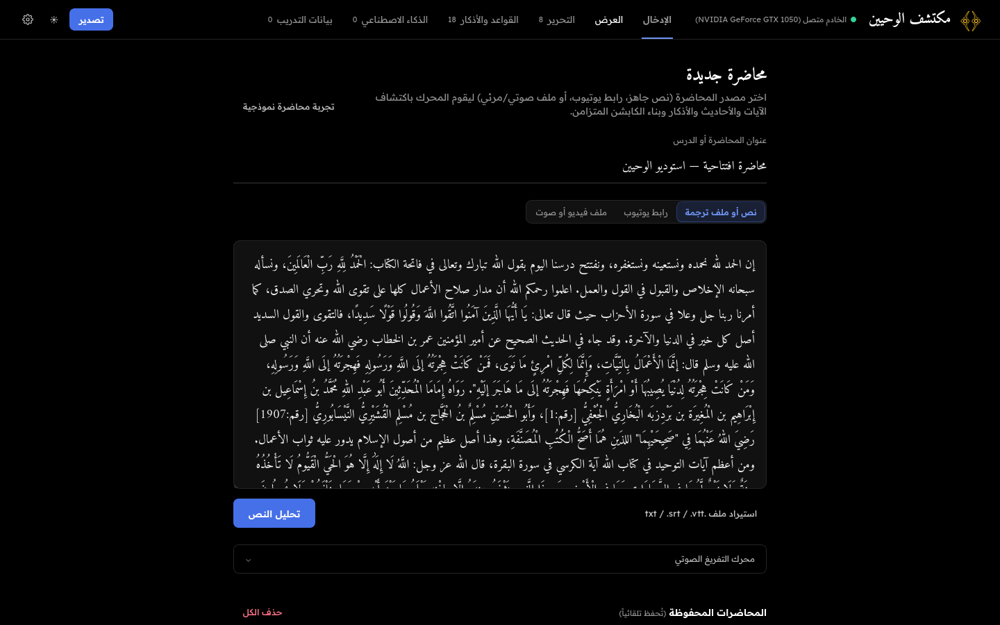
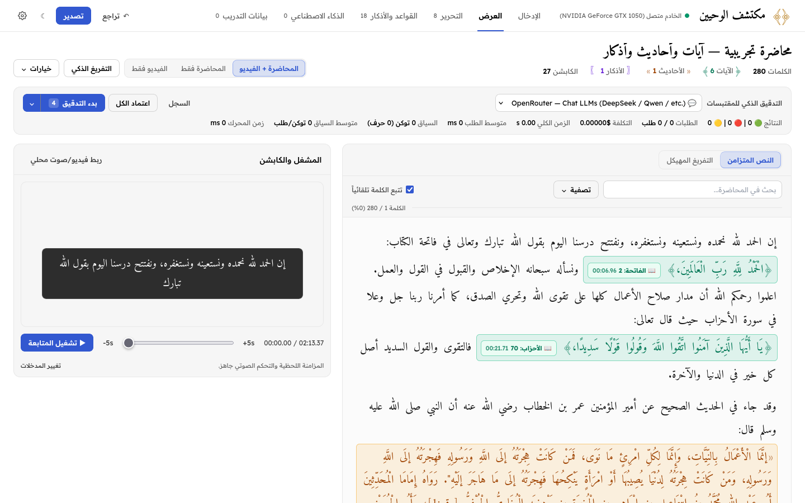
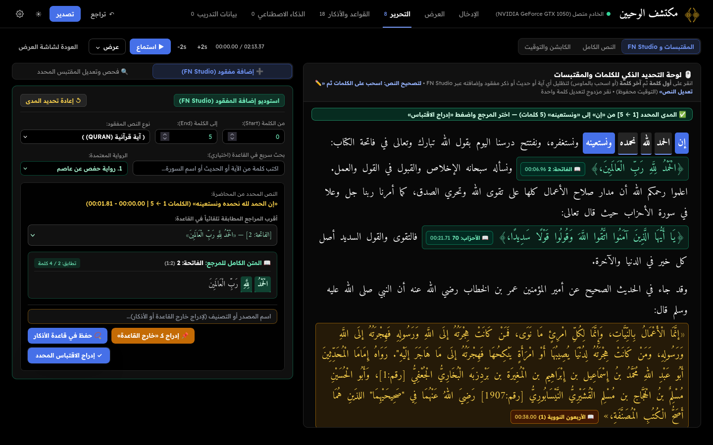
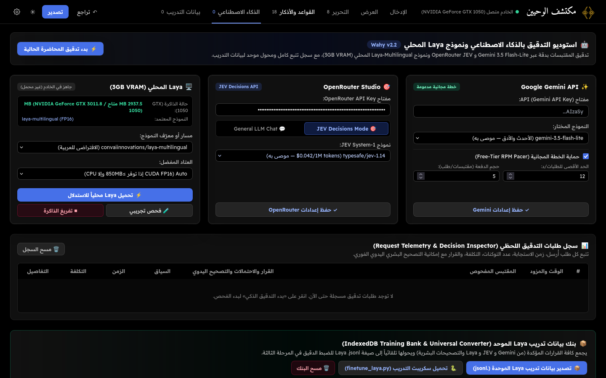
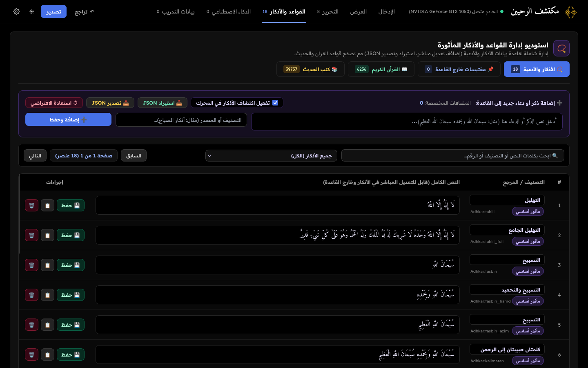

<div align="center">

# مكتشف الوحيين · Wahy Studio

**Transcribe Islamic lectures and lessons, find every Quranic verse, hadith and dhikr in them, check each quote with AI, and export synchronized captions.**


-76B900?logo=nvidia&logoColor=white)



</div>

---

## Contents

- [What it does](#what-it-does)
- [Screenshots](#screenshots)
- [Quick start](#quick-start)
- [AI providers](#ai-providers)
- [AI Tafrigh pipeline](#ai-tafrigh-pipeline)
- [Fine-tuning Laya](#fine-tuning-laya)
- [Project structure](#project-structure)
- [API overview](#api-overview)
- [Running the tests](#running-the-tests)
- [Credits](#credits)

## What it does

| | |
|---|---|
| 🎙️ **Transcription** | Paste text or `.txt/.srt/.vtt`, give a YouTube link, or upload audio/video. Speech goes through local **faster-whisper** or **Groq** (`whisper-large-v3-turbo`). Downloads are cached in `data/media_cache/`. |
| 🔎 **Quote detection** | Matches the transcript against a corpus of **6,236 verses**, **~39,700 hadiths** and an editable **adhkar** list. Handles Uthmani script and the ten Qira'at. |
| 🤖 **AI verification** | Asks a model whether each detected quote is a real quotation or just the sheikh's own words, and whether its boundaries were cut off (`MISSING_START` / `MISSING_END`). Truncated quotes can be auto-expanded with one click. |
| ✍️ **Editorial studio** | Click a word to jump the video to it. Add missed quotes with two clicks (FN Studio), swap in words from the canonical text, and pick between candidate references. |
| 🎬 **Atomic captions** | Exports `SRT`, `VTT` and `ASS` subtitles. A verse or hadith is never split across two captions. Word timings are aligned with LCS. |
| 📑 **AI Tafrigh** | Splits the transcript into sentences, classifies them, fixes typos and builds a structured outline (headings, matn, commentary). Runs `per_sentence` or `windowed`. |
| 📊 **Telemetry and training data** | Logs every AI request with its tokens, cost, latency and raw payload. Your corrections are saved as gold labels and exported as Laya JSONL. |
| 💾 **Local-first** | Lectures and training data are stored in IndexedDB. The app works in light and dark themes, with the UI in Arabic and English. |

## Screenshots

<table>
  <tr>
    <td width="50%"><br><sub><b>Input:</b> text or subtitle file, YouTube link, or audio/video upload</sub></td>
    <td width="50%"><br><sub><b>Display (light):</b> annotated transcript with a live caption preview</sub></td>
  </tr>
  <tr>
    <td><br><sub><b>Editor:</b> FN Studio for adding missed quotes, with reference word chips</sub></td>
    <td><br><sub><b>AI & Logs:</b> Gemini, OpenRouter and local Laya, plus the request inspector</sub></td>
  </tr>
  <tr>
    <td colspan="2"><br><sub><b>Corpora & Adhkar:</b> browse and edit the adhkar, Quran, hadith and custom-quote databases</sub></td>
  </tr>
</table>

## Quick start

### Option 1: browser only

Open `index.html` in Chrome, Firefox or Edge. Without a server you can still:

- paste text or load `.txt / .srt / .vtt` files,
- detect verses, hadiths and adhkar in the browser,
- verify quotes with Gemini or OpenRouter using your own API keys,
- export captions and training data.

Click **«تجربة محاضرة نموذجية»** (try a sample lecture) on the Input tab to see it working right away.

### Option 2: full stack (YouTube, audio upload, local GPU models)

Requirements: Python 3.10+, `ffmpeg` on your `PATH`, and an NVIDIA GPU if you want local inference (3 GB VRAM is enough).

```bash
# Linux / macOS
chmod +x run.sh
./run.sh
```

```bat
:: Windows
run.bat
```

The script creates `.venv`, installs `backend/requirements.txt`, downloads the ~90 MB corpus into `data/corpus.json` from [Wahy-Finder](https://github.com/AbderrahimZineddineEsi/Wahy-Finder) the first time, and serves the app at **http://127.0.0.1:8000**.

To transcribe with Groq instead of local Whisper, set `GROQ_API_KEY` in your environment or paste the key in Settings.

## AI providers

Configure these on the **الذكاء الاصطناعي** (AI & Logs) tab:

| Provider | Use it for | Notes |
|---|---|---|
| **Google Gemini** (`gemini-3.5-flash-lite` and others) | Cheap batched verification | Has a free-tier pacer (12–15 RPM), `Retry-After` backoff, and 5–10 quotes per request |
| **OpenRouter · JEV Decisions** (`typesafe/jev-1.14`) | Calibrated `CORRECT / FALSE / NOT_SURE` probabilities | Uses `/api/alpha/decisions`, about $0.042 per 1M tokens |
| **OpenRouter · Chat LLMs** | Any of 500+ models (DeepSeek, Qwen, Claude, `:free`…) | Shows live prices and has model search |
| **Laya (local)** | Offline verification | `convaiinnovations/laya-multilingual`, about 750 MB VRAM in FP16 and about 30 ms per decision. It unloads Whisper to free memory and falls back to CPU when VRAM is low |

Before a verification run starts, the app shows how many quotes it will check, the estimated tokens, cost and time, and lets you untick quotes. Use the verdict filter (✓ accepted · ? unsure · ✕ ordinary speech · ⏳ unverified) to choose what appears in the transcript and captions. Quotes marked as ordinary speech are hidden, but their words are kept as normal text.

## AI Tafrigh pipeline

The `backend/tafrigh/` package turns a raw transcript into a structured lesson in seven stages. It never changes the original text: every edit is checked by validators and recorded with its source.

```
transcript ─► segment ─► units of work ─► model adapter (Gemini | JEV | Laya)
          ─► validate edits & splits ─► matn alignment ─► outline repair ─► render / export
```

- **Modes:** `per_sentence` (fast, each sentence on its own) or `windowed` (sliding context window).
- **Typo strategy:** `gated` (fix only flagged typos) or `always_correct`, plus a 20-sentence test slice so you can try settings without spending much.
- **Run tracking:** each run is saved under `runs/`. Compare runs with `/api/tafrigh/compare` or `backend/tafrigh/compare_runs.py`.

## Fine-tuning Laya

Your corrections and the models' verdicts are saved together, so negative examples (normal speech the model mistook for a quote) are kept for training. Export them from the **بيانات التدريب** (Training Data) tab, then run:

```bash
# Train only the decision head on a GTX 1050 (< 1.3 GB VRAM)
python backend/finetune_laya.py --data wahy_laya_train.jsonl --head-only --epochs 5

# Full fine-tune on Colab / Kaggle (T4 16 GB)
python backend/finetune_laya.py --data wahy_laya_train.jsonl --full-finetune --epochs 3
```

## Project structure

```
Wahy-Transcriber/
├── index.html               # Single-page app: Input, Display, Editor, Corpora, AI, Training tabs
├── css/styles.css           # Light/dark themes, Amiri + Readex Pro typography
├── js/
│   ├── engine.js / engine_v4.js   # Quote detection and matching
│   ├── corpus-loader.js           # Loads the Quran, hadith and adhkar corpora
│   ├── ai-verifier.js             # Gemini, OpenRouter, Laya clients and Laya converter
│   ├── caption-builder.js         # Atomic SRT/VTT/ASS captions
│   ├── editor.js                  # Editorial studio and FN Studio
│   ├── render.js / events.js      # Rendering and UI wiring
│   ├── state.js                   # App state and IndexedDB stores
│   └── i18n.js / i18n-en.js       # Arabic and English strings
├── backend/
│   ├── app.py               # FastAPI server; also serves the frontend
│   ├── transcriber.py       # faster-whisper and Groq transcription
│   ├── media_processor.py   # yt-dlp and ffmpeg
│   ├── corpus_sources.py    # Corpus download and cache
│   ├── laya_engine.py       # Local Laya inference that respects VRAM limits
│   ├── laya_converter.py    # Audit logs to Laya JSONL
│   ├── finetune_laya.py     # Head-only and full fine-tuning
│   ├── tafrigh/             # AI Tafrigh pipeline (adapters, validators, aligner, exporters)
│   └── tests/               # pytest suite
├── docs/screenshots/        # README images
├── run.sh / run.bat         # One-command launchers
└── pytest.ini
```

## API overview

| Endpoint | Purpose |
|---|---|
| `GET /api/health` | Server, GPU and key status |
| `POST /api/transcribe` · `GET /api/transcribe/progress/{job_id}` | Transcribe a YouTube link or uploaded file, with progress polling |
| `GET/POST/DELETE /api/corpus/...` | Corpus sources and cache |
| `GET /api/laya/status` · `POST /api/laya/{load,unload,predict,convert-dataset}` | Local Laya model |
| `POST /api/openrouter/decisions` | Proxy to the JEV Decisions API |
| `POST /api/tafrigh/{models,segment,run,control,review-action,save-run,compare}` · `GET /api/tafrigh/runs` | AI Tafrigh pipeline |

## Running the tests

```bash
source .venv/bin/activate
pytest
```

## Credits

Built on [faster-whisper](https://github.com/SYSTRAN/faster-whisper), [Groq](https://groq.com), [Laya](https://github.com/convaiinnovations/laya), [🤗 Transformers](https://github.com/huggingface/transformers), [FastAPI](https://fastapi.tiangolo.com), [yt-dlp](https://github.com/yt-dlp/yt-dlp), and the corpus from [Wahy-Finder](https://github.com/AbderrahimZineddineEsi/Wahy-Finder).
