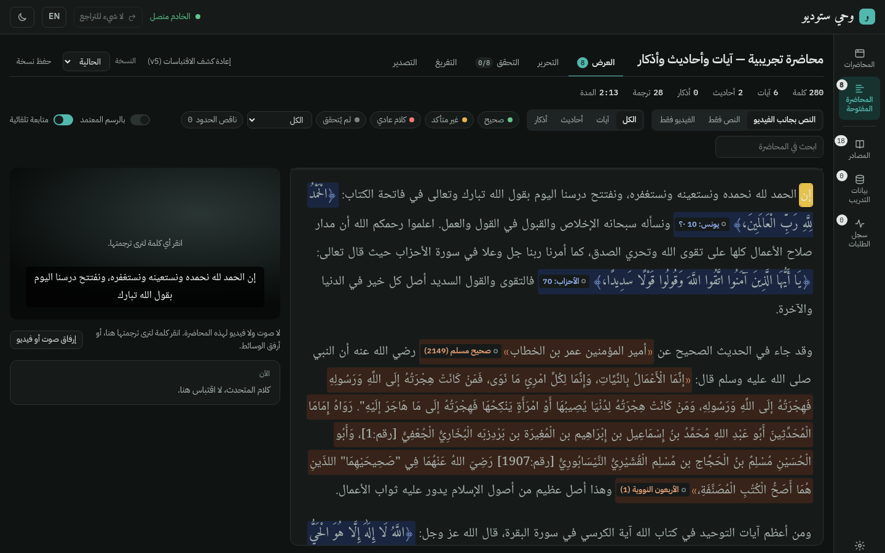
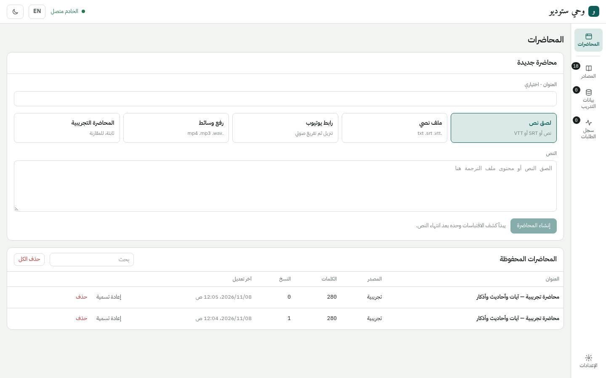
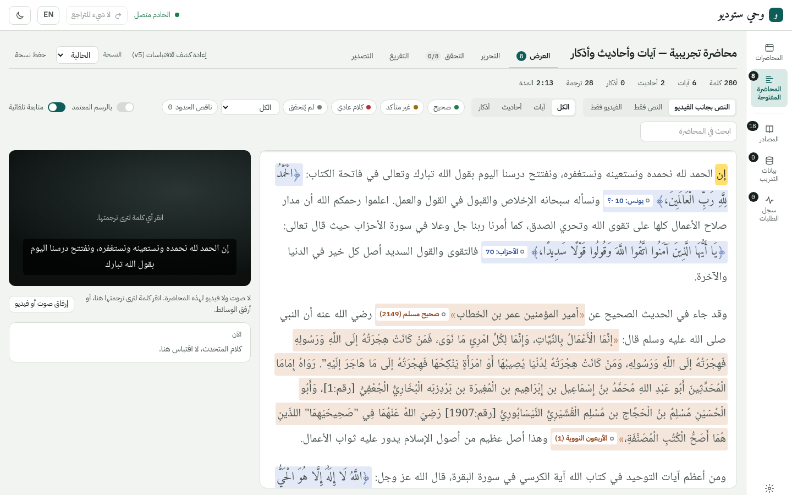
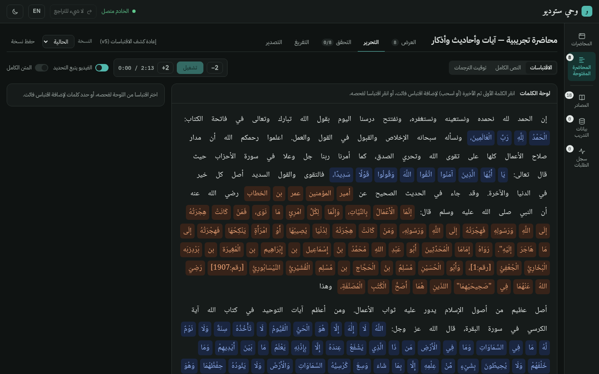
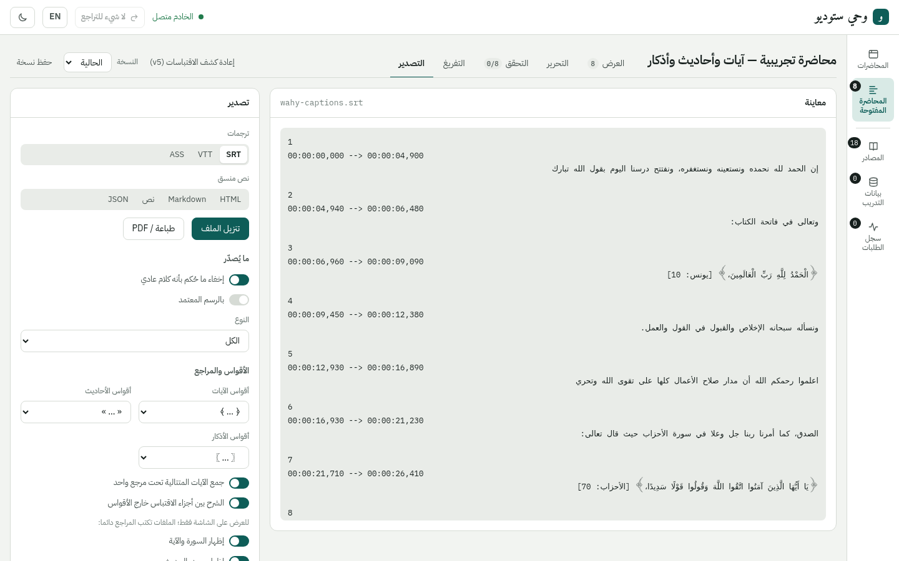
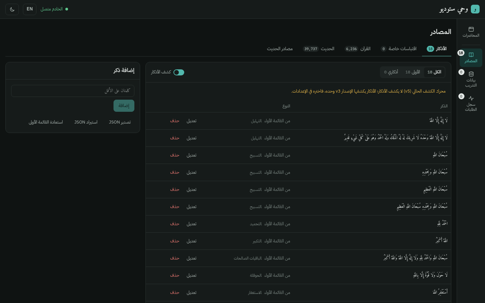

<div align="center">

# تدقيق · Tadqeeq

**Transcribe Islamic lectures and lessons, find every Quranic verse, hadith and dhikr in them, check each quote with AI, and export synchronized captions.**


-76B900?logo=nvidia&logoColor=white)



</div>

---

## Contents

- [What it does](#what-it-does)
- [Screenshots](#screenshots)
- [Quick start](#quick-start)
- [AI providers](#ai-providers)
- [AI Tafrigh pipeline](#ai-tafrigh-pipeline)
- [Fine-tuning Laya](#fine-tuning-laya)
- [Project structure](#project-structure)
- [API overview](#api-overview)
- [Running on Colab](#running-on-colab)
- [Running the tests](#running-the-tests)
- [Credits](#credits)

> **Two editions.** This repo is Tadqeeq's studio edition: the full app plus the Laya research. The product people
> download is the same code without the research, exported by `scripts/export_tadqeeq.sh` to the `tadqeeq` repo.
> See [docs/editions.md](docs/editions.md).

## What it does

| | |
|---|---|
| 🎙️ **Transcription** | Paste text or `.txt/.srt/.vtt`, give a YouTube link, or upload audio/video. Speech goes through local **faster-whisper**, the specialized Arabic Whisper (`Abu-Dju/whisper-large-v3-ar`) or **Groq** (`whisper-large-v3-turbo`). Downloads are cached in `data/media_cache/`. |
| 🔎 **Quote detection** | Matches the transcript against a corpus of **6,236 verses**, **~39,700 hadiths** and an editable **adhkar** list. Handles Uthmani script and the ten Qira'at. The engine (TypeScript, `engine/`) is the same code that builds the training data. |
| 🤖 **AI verification** | Asks a model whether each detected quote is a real quotation or just the sheikh's own words, and whether its boundaries were cut off. Truncated quotes can be auto-expanded with one click. |
| ✍️ **Editing** | Click a word to jump the video to it. Add missed quotes with two clicks, swap in words from the canonical text, move a quote's edges, undo and redo. Every change is kept in an edit log. |
| 🎬 **Atomic captions** | Exports `SRT`, `VTT` and `ASS` subtitles. A verse or hadith is never split across two captions. Word timings are aligned with LCS. |
| 📑 **AI Tafrigh** | Splits the transcript into sentences, classifies them, fixes typos and builds a structured outline (headings, matn, commentary). Runs `per_sentence` or `windowed`. |
| 📊 **Request log and training data** | Logs every AI request with its tokens, cost, latency and raw payload. Your corrections are saved as gold labels and exported as Laya JSONL. |
| 💾 **Local-first** | Everything is stored in SQLite (`data/wahy.db`) and plain files under `data/`. Light and dark themes, UI in Arabic and English. |

## Screenshots

<table>
  <tr>
    <td width="50%"><br><sub><b>Lectures:</b> text or subtitle file, YouTube link, audio/video upload, or the sample lecture</sub></td>
    <td width="50%"><br><sub><b>Lecture (light):</b> annotated transcript with a live caption preview</sub></td>
  </tr>
  <tr>
    <td><br><sub><b>Edit:</b> the word board; select words to add a missed quote</sub></td>
    <td><br><sub><b>Export:</b> SRT, VTT and ASS captions</sub></td>
  </tr>
  <tr>
    <td colspan="2"><br><sub><b>Corpora:</b> the Quran, hadith, adhkar and custom-quote databases</sub></td>
  </tr>
</table>

## Quick start

Requirements: **Node 20+**, **[uv](https://docs.astral.sh/uv/)** (it installs Python 3.12 for you) and `ffmpeg` on your `PATH`. An NVIDIA GPU is only needed for local models (3 GB VRAM is enough).

```bash
git clone https://github.com/AbderrahimZineddineEsi/Wahy-Transcriber.git
cd Wahy-Transcriber
./run.sh
```

The first run installs the Node and Python packages, builds the web app, downloads the ~90 MB corpus into `data/corpus.json` (a [public release asset](https://github.com/AbderrahimZineddineEsi/Wahy-Transcriber/releases/tag/corpus-v1) of this repo, checked against its sha256), and serves everything at **http://127.0.0.1:8000** (one process, one port). Later runs start in seconds.

| Want | Do |
|---|---|
| another port or reachable from the network | `PORT=9000 HOST=0.0.0.0 ./run.sh` |
| local Whisper and local Laya | `WAHY_EXTRAS="local-asr laya" ./run.sh` |
| hot reload while developing | `scripts/dev.sh` (server on 8120, web on 5173) |
| cloud transcription and verification | paste your keys in **Settings** (they are saved to the gitignored `.env`), or put `GROQ_API_KEY`, `GEMINI_API_KEY`, `OPENROUTER_API_KEY` in `.env` |

Click **Sample lecture** on the Lectures screen to see detection working right away.

## AI providers

Configure the keys on the **Settings** screen; every call is listed on the **Requests** screen.

| Provider | Use it for | Notes |
|---|---|---|
| **Google Gemini** (`gemini-3.5-flash-lite` and others) | Cheap batched verification | Free-tier pacer, `Retry-After` backoff, several quotes per request |
| **OpenRouter · JEV Decisions** (`typesafe/jev-1.14`) | Calibrated `CORRECT / FALSE / NOT_SURE` probabilities | Uses `/api/alpha/decisions`, about $0.042 per 1M tokens |
| **OpenRouter · Chat LLMs** | Any of 500+ models (DeepSeek, Qwen, Claude, `:free`…) | Shows live prices and has model search |
| **Laya (local)** | Offline verification | Default: `ZenoAbderrahim/laya-wahy-r6-v3_mixed` (laya-multilingual fine-tuned on Wahy data), about 1.2 GB VRAM and under 1 s per decision on a GTX 1050. One GPU owner loads and frees models so Whisper and Laya never fight for memory. The checkpoint's config says which input it was trained on: consecutive verses go as one passage, with the nearest findings and a yes/no "start / end cut off" boundary — see [docs/laya-finetune/envelope-v2.md](docs/laya-finetune/envelope-v2.md) |

Before a verification run starts, the app shows how many quotes it will check and the estimated tokens, cost and time, and lets you untick quotes. Use the verdict filter to choose what appears in the transcript and captions. Quotes marked as ordinary speech are hidden, but their words are kept as normal text.

## AI Tafrigh pipeline

`server/wahy/features/tafrigh/` turns a raw transcript into a structured lesson in stages. It never changes the original text: every edit is checked by validators and recorded with its source.

```
transcript ─► segment ─► units of work ─► model (Gemini | JEV | Laya)
          ─► validate edits & splits ─► matn alignment ─► outline repair ─► render / export
```

- **Modes:** `per_sentence` (fast, each sentence on its own) or `windowed` (sliding context window).
- **Typo strategy:** `gated` (fix only flagged typos) or `always_correct`, plus a 20-sentence test slice so you can try settings without spending much.
- **Run tracking:** each run is saved under `data/tafrigh_runs/`, survives a restart, and can be compared with another run.

## Fine-tuning Laya

Tadqeeq's Laya models are trained on Kaggle (2× T4) from labelled lecture findings: how the data is made, every run step by step,
and how to read the results are in [docs/laya-finetune/](docs/laya-finetune/) (start with
[kaggle-guide.md](docs/laya-finetune/kaggle-guide.md)); the notebooks are indexed in [notebooks/README.md](notebooks/README.md).
The data code is `server/wahy/laya/` (`laya_v3.py` builds the current dataset of final envelopes, `kaggle/` holds the
training and evaluation scripts, `python -m wahy.laya` is its command line). Your corrections and the models' verdicts
are saved together in the app, so negative examples (normal speech the model mistook for a quote) are kept for training:
export them from the **Training data** screen.

## Project structure

```
Wahy-Transcriber/
├── run.sh                   # One-command launcher (installs, builds, serves on :8000)
├── server/                  # FastAPI app (Python 3.12, uv)
│   ├── wahy/main.py         #   builds the app, mounts every feature, serves web/dist
│   ├── wahy/core/           #   db (SQLite), jobs, gpu owner, engine client, ai provider layer, settings
│   ├── wahy/features/       #   lectures, transcription, corpora, detection, verification, editing,
│   │                        #   export, tafrigh, training, telemetry, settings, jobs
│   ├── wahy/laya/           #   research side: datasets, labelling, Kaggle training scripts
│   └── tests/
├── engine/                  # Quote detection and caption building (TypeScript, runs as a Node worker)
├── web/                     # React app (Vite, Tailwind), Playwright end-to-end tests in web/e2e
├── scripts/                 # test.sh, dev.sh, make_colab_notebook.py, ...
├── notebooks/               # data/ (build + label), kaggle/ (fine-tuning runs), colab/ (run the app on Colab)
├── docs/                    # laya-finetune/, reports/, rewrite/ (roadmap, ADRs, learning log), archive/
└── data/                    # your lectures, corpus, media cache, database (git-ignored)
```

Why it is built this way: [docs/adr/](docs/adr/) and [docs/rewrite/ARCHITECTURE.md](docs/rewrite/ARCHITECTURE.md).

## API overview

The server documents itself: with `./run.sh` running, open **http://127.0.0.1:8000/docs**.

| Area | Endpoints |
|---|---|
| Health and settings | `GET /api/health`, `PUT /api/settings/keys/{provider}`, `/api/settings/laya` (+ `load`, `unload`) |
| Lectures | `/api/lectures` (text, file, sample), `/api/transcriptions/youtube`, `/api/transcriptions/upload` |
| Transcription and jobs | `POST /api/lectures/{id}/transcribe`, `GET /api/transcription/models`, `GET /api/jobs/{id}` |
| Corpora | `/api/corpora/...` (sources, prepare, activate, adhkar, custom quotes, browse) |
| Detection, editing, verification | `POST /api/lectures/{id}/detect`, `.../findings`, edit log with undo and redo, verify |
| Export | `/api/export/style`, per-lecture `.../export` (SRT, VTT, ASS) |
| Tafrigh | `/api/tafrigh/runs`, `.../review`, `.../clone`, `.../export` |
| Training data and requests | `/api/training/...`, `/api/requests` |

## Running on Colab

[](https://colab.research.google.com/github/AbderrahimZineddineEsi/Wahy-Transcriber/blob/tadqeeq/notebooks/colab/tadqeeq_colab_runner.ipynb)

One notebook runs the **whole app** on a free Colab T4 GPU, with every option: Groq, local Whisper, the **specialized Arabic Whisper** and **local Laya** on the GPU, detection, verification, the editor, exports and Tafrigh. It is [`notebooks/colab/tadqeeq_colab_runner.ipynb`](notebooks/colab/tadqeeq_colab_runner.ipynb) (generated by `python scripts/make_colab_notebook.py`).

1. Open it with the badge, then *Runtime → Change runtime type → T4 GPU*.
2. *Runtime → **Run all*** and approve the Google Drive pop-up. The last cell prints your private link after about 5 minutes (about 2 on later runs: the web build, the model downloads and the Python packages are cached or run in parallel).
3. Type your API keys in the app's **Settings**, or put them in Colab Secrets first (`HF_TOKEN` is needed for the Laya checkpoint; `GROQ_API_KEY`, `GEMINI_API_KEY`, `OPENROUTER_API_KEY` are optional). No key is ever stored in the notebook or the repo.

**Your data.** The app keeps everything in `data/` on the Colab machine, which is erased when the session ends. With **Drive ON (the default)** the notebook copies `data/` (database, uploaded media, saved lectures) and the keys file to *My Drive → Tadqeeq* every minute and restores it next time (a *Wahy-Studio* folder from before the rename is moved there the first time). With **Drive OFF** everything is lost at the end of the session; a backup zip is refreshed at `/content/tadqeeq-backup.zip` and offered for download when you stop the app (`RESTORE_BACKUP_ZIP` puts it back).

**Safety.** The link is public on the internet, so the app is locked with a random access token that is part of the link (`WAHY_ACCESS_TOKEN`, `server/wahy/core/access.py`). Do not share the link; clear the notebook's outputs before sharing the notebook.

## Running the tests

```bash
scripts/test.sh       # server (pytest + ruff), engine (vitest + tsc), web (vitest, tsc, eslint, Playwright)
```

## Credits

Built on [faster-whisper](https://github.com/SYSTRAN/faster-whisper), [Groq](https://groq.com), [Laya](https://github.com/convaiinnovations/laya), [🤗 Transformers](https://github.com/huggingface/transformers), [FastAPI](https://fastapi.tiangolo.com), [yt-dlp](https://github.com/yt-dlp/yt-dlp), and the corpus from the Wahy-Finder project.
